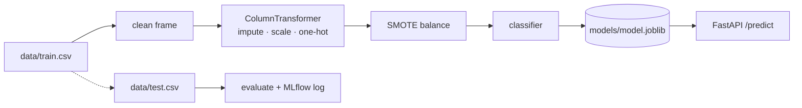

# Insurance Cross-Sell Propensity — MLOps Reference Pipeline

Predicting which policyholders are likely to buy a second insurance product,
wrapped in a reproducible train → serve → monitor loop.

- **Training**: scikit-learn pipeline (impute → scale → one-hot → SMOTE → classifier)
- **Experiment tracking**: MLflow (optional, opt-in)
- **Serving**: FastAPI with a typed request/response contract
- **Packaging**: Docker + docker-compose
- **Quality**: pytest unit + API tests

## Architecture



## Quick start

```bash
git clone https://github.com/sanju-zxt/Insurance-crosssell-mlops.git
cd Insurance-crosssell-mlops

python -m venv .venv
.venv\Scripts\activate        # Windows
source .venv/bin/activate     # Linux / macOS

pip install -r requirements.txt
```

### Train

```bash
python pipelines/train.py
# or with experiment tracking
python pipelines/train.py --mlflow
```

The artifact lands in `models/model.joblib` together with `models/metadata.json`
(metrics, feature order, decision threshold, library versions).

### Serve

```bash
uvicorn xsell.api.main:app --app-dir src --reload
```

Open http://127.0.0.1:8000/docs for the interactive schema.

```bash
curl -X POST http://127.0.0.1:8000/predict -H "Content-Type: application/json" -d '{
  "Gender": "Female",
  "Age": 35,
  "HasDrivingLicense": 1,
  "RegionID": 28,
  "Switch": 0,
  "PastAccident": "No",
  "AnnualPremium": 1416.5
}'
```

### Docker

```bash
docker build -t xsell-api .
docker run -p 8000:8000 xsell-api
```

Full stack with an MLflow tracking server:

```bash
docker compose up --build
```

### Tests

```bash
pytest
```

## Project layout

```
src/xsell/
  config.py        typed settings loader (pydantic)
  data.py          csv read + schema validation + train/test split
  features.py      cleaning and the sklearn preprocessing graph
  evaluate.py      metrics + threshold selection
  registry.py      artifact save/load with metadata
  api/main.py      FastAPI app factory
  api/schemas.py   request/response contract
pipelines/
  train.py         training entrypoint (CLI)
configs/base.yml   single source of truth for every knob
```

## Configuration

Everything is driven by `configs/base.yml` — paths, column names, imputation and
scaling strategy, resampling method, estimator and its hyper-parameters, decision
threshold, artifact location and tracking settings. Nothing is hard-coded in the
Python modules, so an experiment is a config change plus a command.

## Dataset

`data/train.csv` and `data/test.csv` are the public *Health Insurance Cross Sell
Prediction* tables (columns: `Gender`, `Age`, `HasDrivingLicense`, `RegionID`,
`Switch`, `VehicleAge`, `PastAccident`, `AnnualPremium`, `SalesChannelID`,
`DaysSinceCreated`, `Result`). Currency values in `AnnualPremium` are stored in
single-byte encoding, hence the `latin-1` reader setting.

## Licence

MIT — see [LICENSE](LICENSE).
