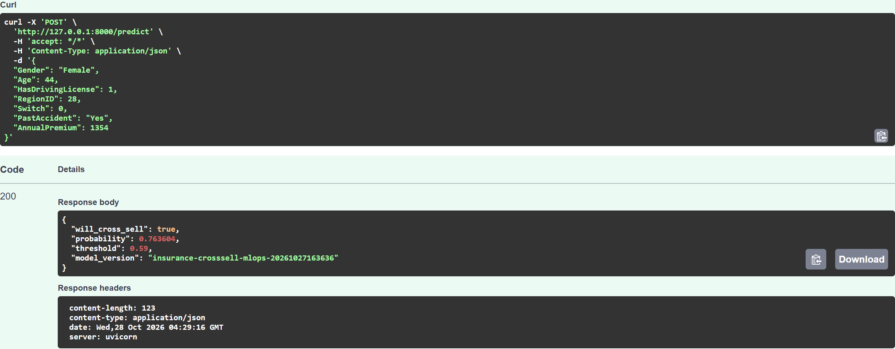
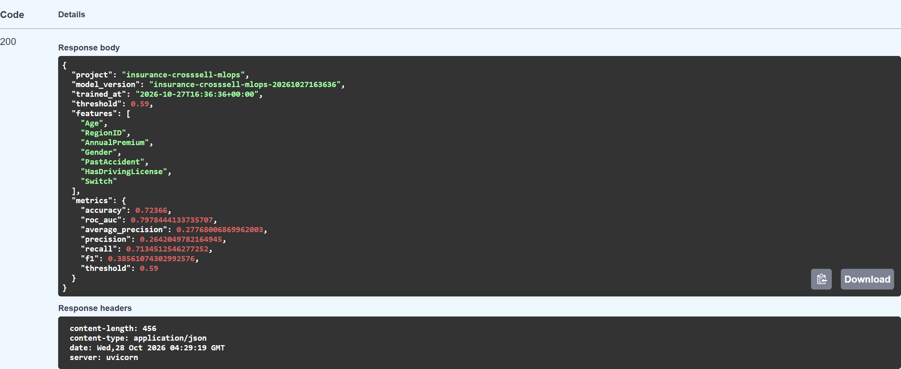
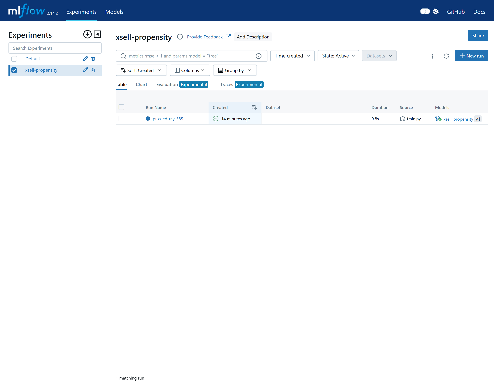
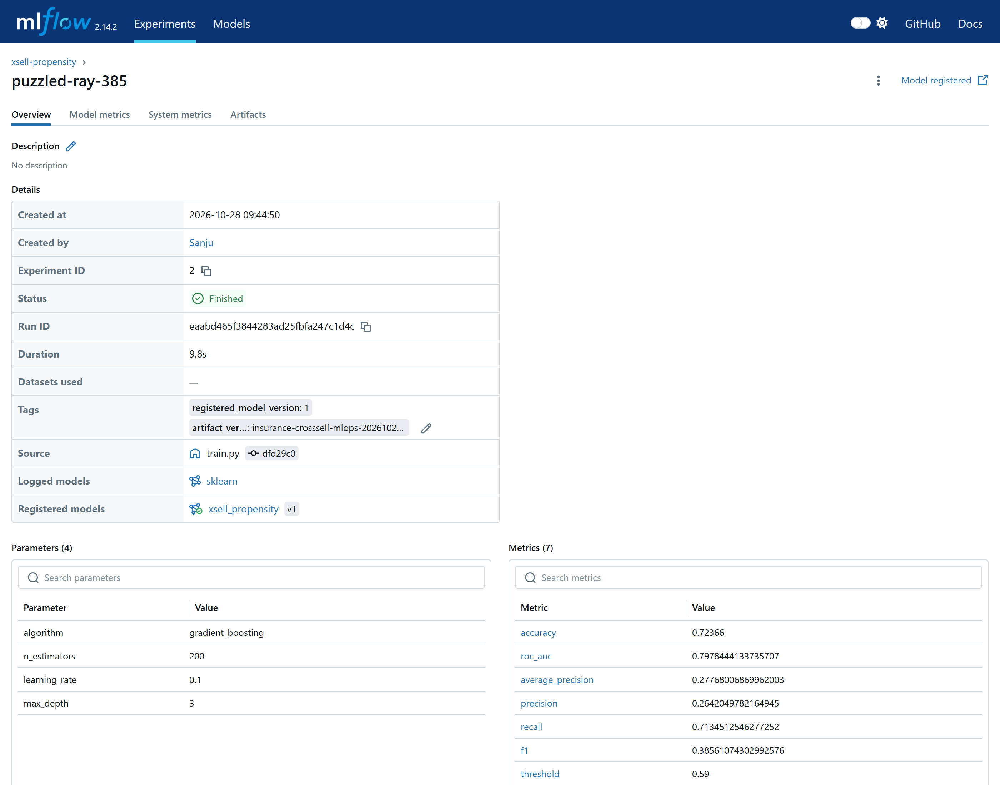
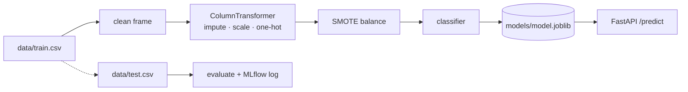

# Insurance Cross-Sell Propensity — MLOps Reference Pipeline.

[](https://github.com/sanju-zxt/Insurance-crosssell-mlops/actions/workflows/ci.yml)

Predicting which policyholders are likely to buy a second insurance product,
wrapped in a reproducible train → serve → monitor loop.

- **Training**: scikit-learn pipeline (impute → scale → one-hot → SMOTE → classifier)
- **Experiment tracking**: MLflow (optional, opt-in)
- **Serving**: FastAPI with a typed request/response contract
- **Packaging**: Docker + docker-compose
- **Quality**: pytest unit + API tests, GitHub Actions CI (tests + image build)

**[DEMO.md](DEMO.md)** — a 90-second, three-screen walkthrough of the running stack,
with the exact payloads, expected responses and the answers to the obvious
follow-up questions.

## Results

100,000 held-out policyholders the model never saw during training:

| metric | value |
| --- | --- |
| ROC AUC | **0.7978** |
| F1 (at threshold 0.59) | 0.3856 |
| Precision / recall | 0.2642 / 0.7135 |
| Accuracy | 0.7237 |
| Average precision | 0.2777 |
| Training rows | 97,314 |

Accuracy is deliberately *not* the headline. Only ~12% of this base buys a second
product, so a model that never predicts a sale already scores 0.88 accuracy and is
worthless. Recall is tuned high on purpose — a wasted phone call costs far less
than a missed sale — which is why the decision threshold sits at **0.59**, not 0.5.

**The number a retention team would actually act on** — 500 rows from the test set,
scored through the running API:

| cohort | actual buy-rate |
| --- | --- |
| top 10% of scores | **30.0%** |
| whole sample | 11.8% |
| lift | **2.5×** |

Call the top decile, skip the rest. Training is seeded and deterministic, so
`python pipelines/train.py` reproduces the metrics above exactly.

## What it looks like

**1. A prediction, with the request that produced it** — `POST /predict`, Swagger UI
against the Docker container:



**2. The served model describes itself** — `GET /model/info` returns the version,
threshold, feature order and every metric it was trained with:



**3. Every training run is tracked** — the `xsell-propensity` experiment in MLflow:



**4. …and registered as a versioned model** — run detail with the logged metrics and
the `xsell_propensity` version it produced:



## Architecture



## Quick start

```bash
git clone https://github.com/sanju-zxt/Insurance-crosssell-mlops.git
cd Insurance-crosssell-mlops

python -m venv .venv
.venv\Scripts\activate        # Windows
source .venv/bin/activate     # Linux / macOS

pip install -r requirements.txt
```

That is the whole setup. The trained artifact is committed to the repository, so
the next step after `pip install` is serving (§ Serve) — no training run needed.

### Trained artifact (committed)

`models/model.joblib` and `models/model.metadata.json` **are versioned in git**
(~420 KB compressed). A fresh clone therefore serves predictions immediately:
`git clone` → `pip install -r requirements.txt` → `uvicorn …` and `/health`
reports `model_loaded: true` while `/predict` answers with real probabilities.

Committed artifact:

| field | value |
| --- | --- |
| file | `models/model.joblib` (432 462 bytes, joblib `compress=3`) |
| sidecar | `models/model.metadata.json` (features, threshold, metrics, library versions) |
| version | `insurance-crosssell-mlops-20261027163636` |
| roc_auc | `0.7978444133735707` |
| f1 / threshold | `0.38561074302992576` / `0.59` |
| trained with | scikit-learn 1.5.1 on Python 3.12.10 |

It is **reproducible, not hand-made**: `python pipelines/train.py` is seeded and
deterministic, so re-running it on the committed `data/train.csv` prints the same
`roc_auc=0.7978 f1=0.3856 threshold=0.590` and rewrites the same artefact (only the
`version`/`trained_at` timestamp inside the sidecar changes). Retraining without
committing the new files leaves the repo serving the old model, so **commit the
regenerated `models/model.joblib` + `models/model.metadata.json` whenever a change
to the data, features or `configs/base.yml` moves the metrics.**

Everything training-only stays out of git: `data/` is already in the repo from the
initial commit so a clone can retrain, while `mlruns/`, `mlflow.db` and the local
virtualenv are ignored, and `.dockerignore` keeps `data/` out of the image.

### Train

```bash
python pipelines/train.py
# or with experiment tracking
python pipelines/train.py --mlflow
```

The artifact lands in `models/model.joblib` together with
`models/model.metadata.json` (metrics, feature order, decision threshold, library
versions). The sidecar is named after the artifact, so several models can live in
`models/` at once — e.g. `model-logistic.joblib` + `model-logistic.metadata.json`.

### Track experiments

`--mlflow` logs params/metrics/model and registers a model version, using the store
configured in `configs/base.yml` (`tracking_uri: sqlite:///mlflow.db`, resolved
against the repository root). A database store is required: the MLflow **model
registry does not work on a plain `file:` store**.

```bash
pip install -r requirements-tracking.txt                       # mlflow 2.14.3 (+ setuptools<81, sqlalchemy<2.1)
python pipelines/train.py --mlflow                             # run + registered version
python -m mlflow ui --backend-store-uri sqlite:///mlflow.db --port 5000
```

Then open http://127.0.0.1:5000. Each run creates a new version of the registered
model `xsell_propensity`. Point `MLFLOW_TRACKING_URI` at a tracking server (the
`mlflow` service in `docker-compose.yml`, which also binds port 5000 — run it *or*
the local UI, not both) to keep results off the local disk; `mlflow.db` and
`mlruns/` are gitignored.

To log against the containerised server instead of the local store:

```bash
docker compose up -d mlflow
export MLFLOW_TRACKING_URI=http://127.0.0.1:5000     # PowerShell: $env:MLFLOW_TRACKING_URI="http://127.0.0.1:5000"
python pipelines/train.py --mlflow
```

The server runs with `--artifacts-destination /mlflow/artifacts` and
`--default-artifact-root mlflow-artifacts:/`, so artifacts are uploaded **through**
the server into the mounted volume. Without that pair of flags each client writes
to its own disk (MLflow resolves the server's local path against the *client*
filesystem), which silently scatters artifacts and leaves the run unusable from any
other machine.

### Serve

```bash
uvicorn xsell.api.main:app --app-dir src --reload
```

Open http://127.0.0.1:8000/docs for the interactive schema.

```bash
curl -X POST http://127.0.0.1:8000/predict -H "Content-Type: application/json" -d '{
  "Gender": "Female",
  "Age": 35,
  "HasDrivingLicense": 1,
  "RegionID": 28,
  "Switch": 0,
  "PastAccident": "No",
  "AnnualPremium": 1416.5
}'
```

### Docker

The image ships the committed artifact, so no training step is required (`docker
build` copies `models/` straight from the checkout; mount your own `models/` over
it to run a different model):

```bash
docker build -t xsell-api .        # models/model.joblib is already in the repo
docker run -p 8000:8000 xsell-api
```

To rebuild the artifact first — e.g. after changing `configs/base.yml` — run
`python pipelines/train.py` before `docker build`.

Full stack with an MLflow tracking server:

```bash
docker compose up --build
```

The container healthcheck asserts `model_loaded` in `/health`, not just HTTP 200 —
an image without an artifact reports `degraded` and stays `unhealthy` instead of
pretending to be fine while `/predict` returns 503.

### Tests

```bash
pytest
```

47 tests: data/schema loading, feature graph and resampling, threshold selection,
artifact round-trip plus sidecar lineage, config parsing, and the API contract
(including `422` on malformed payloads and `503` when no model is loaded). CI runs
the suite and builds the image on every push to `main`:
[`.github/workflows/ci.yml`](.github/workflows/ci.yml).

## Project layout

```
src/xsell/
  config.py        typed settings loader (pydantic)
  data.py          csv read + schema validation + train/test split
  features.py      cleaning and the sklearn preprocessing graph
  evaluate.py      metrics + threshold selection
  registry.py      artifact save/load with metadata
  api/main.py      FastAPI app factory
  api/schemas.py   request/response contract
pipelines/
  train.py         training entrypoint (CLI)
configs/base.yml   single source of truth for every knob
```

## Configuration

Everything is driven by `configs/base.yml` — paths, column names, imputation and
scaling strategy, resampling method, estimator and its hyper-parameters, decision
threshold, artifact location and tracking settings. Nothing is hard-coded in the
Python modules, so an experiment is a config change plus a command.

## Dataset

`data/train.csv` and `data/test.csv` are the public *Health Insurance Cross Sell
Prediction* tables (columns: `Gender`, `Age`, `HasDrivingLicense`, `RegionID`,
`Switch`, `VehicleAge`, `PastAccident`, `AnnualPremium`, `SalesChannelID`,
`DaysSinceCreated`, `Result`). Currency values in `AnnualPremium` are stored in
single-byte encoding, hence the `latin-1` reader setting.

The dataset and the problem framing are public; the package, config schema, API
contract, tests, container and CI in this repository are written from scratch.

## What I would do next

Deliberately out of scope for this build, in the order I would pick them up:

1. **Drift monitoring.** Log the feature distribution of every scoring batch and
   alert on PSI/KS movement in `AnnualPremium`, `RegionID` and `PastAccident`. The
   metrics above are one snapshot in time; nothing here would notice the population
   shifting under it.
2. **Promotion through the registry instead of a file.** The API loads
   `models/model.joblib` via `XSELL_MODEL_PATH`. Loading
   `models:/xsell_propensity/Production` would make promotion a registry action, so
   serving a new model stops being "copy a file and redeploy".
3. **A retrain gate in CI.** Scheduled retrain that only registers a new version if
   `roc_auc` does not regress and the top-decile lift holds — the guard that stops
   silent quality decay.
4. **Async batch scoring.** `/predict/batch` is synchronous and fine for hundreds of
   rows; production scoring of a full book wants a queued job plus object storage
   instead of a local volume.
5. **Enforced data contract.** Schema validation runs on load, but there is no
   `pandera`-style contract on request payloads, and no test that the training CSV
   still satisfies the expected dtypes.
6. **Calibration check.** Thresholds were chosen on F1; for campaign planning I
   would add a reliability curve and report expected-value-per-contact.

## Licence

## Frontend

See [FRONTEND_SETUP.md](FRONTEND_SETUP.md) for instructions on running the React frontend alongside the FastAPI backend.

## Licence

MIT — see [LICENSE](LICENSE).
